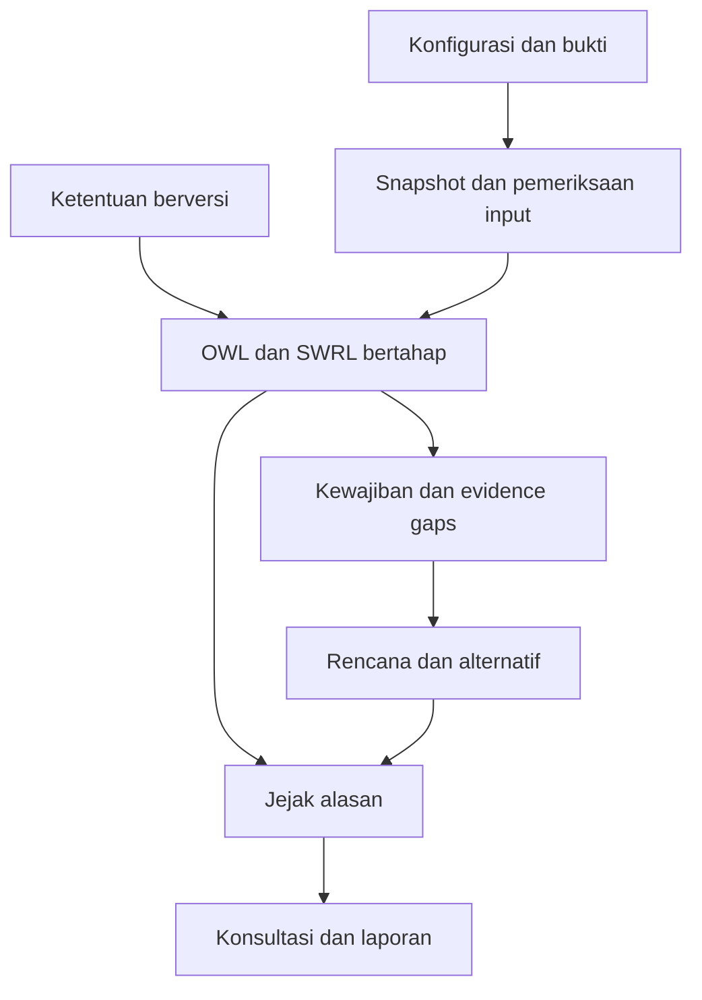

# EnviroPermit-KBS — Project and Implementation Plan

**Goal:** Membangun sistem pakar yang menalar kewajiban lingkungan dari konfigurasi proyek multiaktivitas, mendiagnosis hambatan, menyusun rencana persetujuan, dan menjelaskan perbedaan antaralternatif proyek.

**Architecture:** Knowledge base OWL 2 DL memodelkan kegiatan, bukti, ketentuan, kewajiban, dan ketergantungan. Reasoner DL dan tahap SWRL terbatas menghasilkan keputusan; planner generik menyusun tindakan dari pengetahuan tersebut. Setiap alternatif diproses sebagai snapshot terpisah dan memiliki penjelasan yang menghubungkan hasil dengan fakta serta sumbernya.

**Tech Stack:** Protégé; OWLAPI/HermiT; SWRLAPI dengan engine Drools; Python 3.12, FastAPI, RDFLib, pySHACL; React/TypeScript; penyimpanan kasus lokal berbasis JSON/SQLite. Exact dependencies dikunci setelah compatibility smoke test pertama. OWLready2 0.51 tetap digunakan untuk mereproduksi spike yang sudah tersedia.

**Spec:** Bagian 1–9 dokumen ini. Implementasi: bagian 10–14.

**Tanggal:** 14 November 2026, Asia/Jakarta.  
**Status:** Arah multiaktivitas sudah dipilih pengguna; rencana implementasi disiapkan. Spike air limbah sudah dijalankan sebelumnya. Aplikasi lengkap belum dibangun.

## Global Constraints

- Pertahankan judul dan tujuan multiaktivitas. Pembagian milestone adalah urutan pengerjaan.
- Gunakan TBox, RBox, ABox, OWL 2 DL/SROIQ(D), serta role/property hierarchy H secara bermakna.
- Sesuai pembaruan pengguna, pusatkan pengetahuan domain dalam `kb/enviropermit.ttl`, memakai OWL dan SWRL standar yang dapat diedit di Protégé. Pisahkan core OWL 2 DL dan tahap SWRL melalui ekstraksi saat runtime. Jangan menyebut gabungan sembarang OWL+SWRL sebagai ontology SROIQ(D) yang terjamin decidable.
- Path file modul KB pada rancangan awal di bawah diperlakukan sebagai pembagian bagian logis dalam TTL tunggal, bukan sumber pengetahuan aktif tambahan. Manifest release dan data kasus tetap terpisah.
- Target sekitar 80% KBR berarti dominasi pengetahuan eksplisit dalam keputusan domain; jangan menggunakan jumlah baris kode atau kelas sebagai ukurannya.
- Referensi primer mencukupi untuk memulai dan mengembangkan knowledge base. Wawancara pakar tidak menjadi dependency.
- PDF materi kuliah adalah bahan belajar; persyaratan proyek bersumber dari pembahasan pengguna.
- Bedakan APPLICABLE, NOT_APPLICABLE dengan bukti eksplisit, UNRESOLVED, OUT_OF_SCOPE, dan CONFLICTING.
- Semua hasil terikat pada assessment_id, scenario_id, evidence_snapshot_id, tanggal penilaian, dan kb_release_id.
- Fakta hipotetis atau hasil yang diharapkan dari rencana tidak boleh berubah menjadi bukti bahwa tindakan sudah terlaksana.
- Nilai ambang, pengecualian, kewenangan, dan ketergantungan hukum disimpan dalam KB/registry yang dapat ditelusuri.
- Sistem harus dapat berjalan secara lokal dengan kasus sintetis; tidak memerlukan LLM, GPU, API berbayar, atau integrasi OSS.
- Antarmuka dan penjelasan menggunakan Bahasa Indonesia dengan istilah teknis English bila lebih jelas.

## Review Focus

1. Perubahan campuran: perubahan identitas tidak menghapus konsekuensi penambahan kapasitas; diuji di T3 dan T5.
2. Bukti dari skenario, outlet, atau periode lain tidak boleh memenuhi prasyarat kasus saat ini; diuji di T1, T4, T5, T7.
3. Banyak kegiatan dan outlet tidak otomatis berarti semua kewajibannya dapat digabung atau diwakili satu persetujuan; diuji di T5.
4. Hubungan pengajuan, penerbitan, uji coba, dan operasi tidak boleh disamakan; diuji di T6.
5. Perubahan sebagian ketentuan, satuan salah, dan nilai tepat pada batas harus ditangani tanpa aturan tebakan; diuji di T2–T4.

---

## 1. Proyek yang dikerjakan

**Nama:** EnviroPermit-KBS.

**Judul:** Sistem Pakar Berbasis Ontologi untuk Penalaran Kewajiban Lingkungan dan Perencanaan Persetujuan Proyek Multiaktivitas.

**English title:** An Ontology-Based Expert System for Environmental Obligation Reasoning and Approval Planning in Multi-Activity Projects.

Pertanyaan utamanya: *Dengan konfigurasi kegiatan, lokasi, skala, persetujuan yang ada, dan perubahan yang direncanakan, kewajiban apa yang muncul, bagaimana kewajiban tersebut berhubungan, bukti apa yang kurang, dan rencana apa yang dapat ditempuh?*

Pengguna awal adalah staf lingkungan/perizinan internal perusahaan, konsultan junior, dan mahasiswa yang menganalisis kasus proyek. Nilai produknya adalah membantu menyusun pemahaman kasus secara konsisten dan dapat diperiksa. Kegunaan bagi kelompok tersebut merupakan hipotesis produk yang dapat dievaluasi melalui demonstrasi tugas.

Kontribusi yang akan dibangun: penggabungan kewajiban pada konfigurasi proyek, penalaran dengan bukti tidak lengkap, graph ketergantungan persetujuan, dan penjelasan perubahan hasil antaralternatif. Klaim kebaruan penelitian ditetapkan melalui literature review terpisah pada T10.

## 2. Lingkup solusi utuh

Vertical demonstrasi pertama adalah **manufaktur makanan untuk konsumsi manusia**, dengan kegiatan produksi, sumber emisi stasioner/boiler, serta pengolahan dan pembuangan air limbah industri. Pemilihan profil KBLI rinci dan standar teknis dilakukan pada T2 melalui naskah resmi.

| Modul inti | Hasil yang harus terlihat pada versi lengkap pertama |
|---|---|
| Konfigurasi proyek | Kegiatan utama/pendukung, fasilitas, outlet/sumber emisi, lokasi, kapasitas, persetujuan yang ada, perubahan |
| Penapisan lingkungan | Jalur dokumen untuk profil dan kondisi yang telah dikodekan, beserta pemicu dan pengecualian |
| Air limbah | Kewajiban dan kebutuhan bukti terkait pengelolaan/pembuangan serta perubahan Pertek |
| Emisi | Kewajiban dan kebutuhan bukti dari sumber emisi yang dimodelkan |
| Komposisi kewajiban | Menggabungkan keluaran beberapa modul sambil mempertahankan subjek, cakupan, dan prasyaratnya |
| Planning | Tindakan, prasyarat, langkah yang dapat berjalan paralel, hambatan, dan hal yang perlu diverifikasi |
| What-if | Membandingkan konfigurasi proyek dengan tujuan yang sama serta memperlihatkan perubahan kewajiban/rencana |
| Penjelasan | Fakta → axiom/rule → ketentuan sumber → hasil |

Versi lengkap pertama mencakup kasus kegiatan baru dan perubahan kegiatan pada profil yang dikodekan. Data lokasi/kawasan sensitif menjadi bagian penapisan; kondisi yang belum didukung tetap terlihat sebagai kebutuhan bukti atau di luar cakupan. Tidak diperlukan peta GIS otomatis untuk mengawali penalaran lokasi.

Integrasi pengajuan OSS, seluruh KBLI, perhitungan dispersi fisik, optimasi biaya, dan pengajuan dokumen otomatis menjadi pengembangan berikutnya. Batas ini tidak menghapus kemampuan komposisi, planning, atau what-if dalam versi pertama.

## 3. Kasus demonstrasi utama

Sebuah perusahaan makanan ingin meningkatkan produksi. Rencana memuat penambahan lini produksi, perubahan sumber panas, dan perubahan pengelolaan air limbah. Pengguna memasukkan bukti kondisi awal dan konfigurasi yang diusulkan.

Tiga alternatif demonstrasi disiapkan sebagai konfigurasi hipotetis yang lengkap:

- **A:** kapasitas produksi bertambah, boiler ditambahkan, dan desain pengolahan air limbah berubah.
- **B:** tujuan kapasitas sama, tetapi konfigurasi sumber panas berbeda; perbedaan kondisi sumber emisi harus dicatat secara eksplisit.
- **C:** tujuan kapasitas sama, tetapi konfigurasi pengolahan air limbah berbeda; hasil kajian teknis yang tersedia dapat berbeda atau masih belum diketahui.

Ketiga alternatif merupakan input yang harus dinilai; tidak ada asumsi bahwa B/C otomatis bebas kewajiban atau secara teknis lebih baik. Pada tahap lanjutan, sistem dapat menghasilkan kombinasi dari pilihan desain terbatas yang telah dimodelkan.

Alur demonstrasi:

1. Masukkan tujuan, kegiatan, lokasi, kondisi awal, dan bukti.
2. Tampilkan kewajiban per kegiatan serta hubungan lintas kegiatan.
3. Buka satu hambatan untuk melihat fakta, syarat yang belum terpenuhi, dan sumbernya.
4. Tampilkan rencana sebagai graph dengan status setiap prasyarat.
5. Ganti konfigurasi pada salinan skenario; hitung ulang tanpa membawa kesimpulan lama.
6. Bandingkan kewajiban yang muncul, tetap, hilang dengan alasan sah, atau belum dapat diputuskan.
7. Ekspor ringkasan dan daftar bukti yang perlu dilengkapi.

Contoh kalimat keluaran: “Jalur dokumen teknis untuk outlet O1 belum dapat ditentukan karena penilaian luas sebaran dampak pada konfigurasi B belum tersedia.” Sistem juga harus menjelaskan bukti apa yang akan membedakan cabang keputusan.

## 4. Competency questions dan kepemilikan keputusan

| ID | Pertanyaan | Pemilik logika | Task |
|---|---|---|---|
| CQ01 | Kegiatan apa yang termasuk dalam skenario ini? | OWL relasi dan klasifikasi | T1 |
| CQ02 | Ketentuan versi mana yang sesuai dengan tanggal dan lingkup kasus? | Registry ketentuan dan pemilihan rule pack eksplisit | T2 |
| CQ03 | Jalur dokumen lingkungan mana yang didukung fakta? | OWL/SWRL dan tabel kriteria dalam KB | T3 |
| CQ04 | Kewajiban apa yang dipicu kegiatan air limbah? | OWL/SWRL | T4 |
| CQ05 | Kewajiban apa yang dipicu sumber emisi? | OWL/SWRL | T4 |
| CQ06 | Apa konsekuensi perubahan campuran? | OWL/SWRL | T3, T5 |
| CQ07 | Kewajiban mana yang terkait persetujuan yang sama atau tetap terpisah? | Relasi cakupan dan aturan komposisi KB | T5 |
| CQ08 | Bukti apa yang kurang, tidak cocok, atau bertentangan? | Shapes untuk kelengkapan; KB untuk relevansi/konsekuensi | T1, T5 |
| CQ09 | Langkah mana yang mempunyai prasyarat dan mana yang dapat paralel? | Ketergantungan/action templates KB; traversal generik | T6 |
| CQ10 | Apa yang menghalangi suatu cabang rencana? | KB syarat, fakta pemenuhan, dan status bukti | T6 |
| CQ11 | Bagaimana hasil berubah pada alternatif konfigurasi? | Inferensi ulang per snapshot dan perbandingan generik | T7 |
| CQ12 | Apa alasan dan sumber setiap keputusan? | Axiom/rule provenance dan evidence trace | T8 |

Audit target 80% dilakukan atas katalog keputusan domain yang dibekukan sebelum evaluasi. Catat owner logika, sumber, dan bukti eksekusi untuk setiap kategori. Laporkan distribusi kategori dan hasil benchmark; jangan membesar-besarkan angka dengan memperbanyak keputusan sepele. Normalisasi satuan, penyimpanan, rendering, dan sorting graph adalah layanan pendukung.

## 5. Model pengetahuan

### Entitas utama

| Kelompok | Entitas |
|---|---|
| Kasus | Project, Scenario, Assessment, EvidenceSnapshot, ProjectGoal |
| Konfigurasi | Activity, MainActivity, SupportingActivity, Facility, WastewaterOutlet, EmissionSource, Location |
| Perubahan | ProposedChange, CapacityChange, TechnicalChange, AdministrativeChange |
| Pengetahuan | SourceDocument, Provision, RulePack, Criterion, ExceptionCondition |
| Bukti | Observation, Measurement, ScreeningFinding, DocumentEvidence, CompletenessAssertion |
| Keputusan | ObligationAssessment, ObligationKind, EvidenceGap, Conflict, ApplicabilityFinding |
| Rencana | PlanCandidate, ActionInstance, ActionTemplate, RequirementGroup, PlanMilestone, ExpectedEffect |

Satu `ObligationAssessment` terkait tepat satu assessment dan subjek kegiatan/fasilitas yang dinilai. Satu dokumen dapat mendukung beberapa keputusan hanya jika kesesuaian lingkupnya didukung. Kewajiban memiliki nilai identitas konseptual yang stabil, tetapi assessment dan action instance selalu spesifik skenario.

### Penggunaan fitur formal

| Fitur | Pemakaian yang bermakna | Bukti pengujian |
|---|---|---|
| Hierarki kelas | Kegiatan pendukung dan jenis perubahan mewarisi sifat umum | Klasifikasi yang tidak diassert langsung |
| H / subproperty | `hasWaterTechnicalChange` merupakan jenis `hasTechnicalChange` | Penghapusan hierarchy mematahkan kasus terkait |
| R / property chain | Relasi kegiatan dan kewajibannya menurunkan hubungan kewajiban proyek | Triple hasil inferensi berbeda dari input |
| I / inverse | Kegiatan milik skenario dapat menelusuri konteks penilaiannya | Tidak perlu mengisi dua arah secara manual |
| O / nominal | Kategori keputusan dan inventaris lengkap yang dinyatakan eksplisit | Penutupan berlaku hanya dengan bukti kelengkapan |
| Q / qualified cardinality | Tepat satu snapshot per assessment; hubungan identitas keputusan yang terdefinisi | Dua snapshot berbeda menghasilkan konflik |
| D / datatype | Nilai terukur, satuan yang dinormalisasi, serta pembandingan kriteria | Batas bawah/tepat/atas dan satuan tidak cocok |
| S / transitivity | Ketergantungan wajib pada satu cabang rencana terpilih | Prasyarat tidak langsung dapat ditelusuri |
| Boolean / quantifiers | Gabungan syarat, pengecualian eksplisit, dan cakupan keseluruhan inventaris | Perubahan campuran dan data tidak lengkap |

SROIQ(D) memiliki global restrictions; properti hasil chain/transitif tidak digunakan dalam cardinality yang mensyaratkan simple property. Closure ketergantungan hanya menyatakan prasyarat, bukan bahwa suatu persetujuan pasti akan terbit. Alternatif OR tidak boleh diubah menjadi kumpulan prasyarat AND. [R6]

### Status penalaran

Applicability dan fulfillment adalah dua sumbu berbeda:

- Applicability: APPLICABLE / NOT_APPLICABLE / UNRESOLVED / OUT_OF_SCOPE / CONFLICTING.
- Fulfillment: SATISFIED / UNSATISFIED / UNKNOWN / CONFLICTING.

Kewajiban dapat APPLICABLE tetapi pemenuhannya UNKNOWN. Ketidakhadiran dokumen dalam input bukan bukti bahwa dokumen tidak ada. Pernyataan NOT_APPLICABLE memerlukan syarat pengecualian atau bukti negatif eksplisit yang lingkupnya sesuai.

Setiap case diproses dalam reasoning context terpisah. Bukti konflik dikarantina; keluaran normal dari ontology tidak konsisten tidak diteruskan sebagai keputusan.

## 6. Akuisisi pengetahuan dan sumber

Alur kerja setiap ketentuan:

1. Simpan identitas dokumen, URL resmi, versi/tanggal, lokasi pasal/lampiran, dan salinan yang diperiksa.
2. Tulis paraphrase atomik: subjek, kondisi, konsekuensi, pengecualian, serta bukti yang diperlukan.
3. Bedakan ketentuan langsung, interpretasi pemodelan, dan asumsi kasus.
4. Tulis expected outcome kasus positif, negatif yang berdasar, belum diketahui, serta kasus batas sebelum menulis aturan.
5. Formalisasikan, jalankan, lalu tautkan rule/axiom ke ketentuan dan kasus.

| Sumber | Pemanfaatan | Status pekerjaan |
|---|---|---|
| PP 22/2021 | Persetujuan lingkungan, perubahan, hubungan kewajiban | Bagian perubahan telah dipakai dalam spike; perlu diperluas untuk scope v1 |
| Permen LHK 4/2021 | Penapisan kegiatan, skala, dan kondisi lokasi | Naskah resmi tersedia; ekstraksi profil terpilih di T2–T3 |
| Permen LHK 5/2021 | Pertek/SLO air limbah dan emisi serta prosedurnya | Cabang air limbah diuji; cabang emisi dibangun di T4 |
| PP 28/2025 | Konteks perizinan berusaha dan persyaratan dasar | Gunakan versi ini dalam konteks yang relevan; dokumen menggantikan PP 5/2021 |
| Permen LH/BPLH 22/2025 | Kewenangan penerbitan persetujuan lingkungan | Ekstraksi cabang yang relevan di T2/T5 |
| Perubahan ketentuan sektoral | Applicability per ketentuan | Registry mencatat pencabutan sebagian; hindari status satu dokumen untuk semua pasal |

Rujukan PP 28/2025 dan Permen LH/BPLH 22/2025 telah ditemukan pada JDIH resmi. Informasi metadata tidak cukup untuk menulis cabang keputusan; implementer membaca batang tubuh dan lampiran yang tepat. [R3–R5]

Gunakan schema `ProvisionRecord`: `id`, `document_id`, `locator`, `source_url`, `effective_from`, `effective_to`, `scope`, `supersedes`, `interpretation_note`, `review_status`, `rule_ids`, `case_ids`. Interval versi menggunakan tanggal yang disalin dari sumber; tanggal tidak diketahui tidak diisi dengan tebakan. Pack yang tumpang tindih tanpa prioritas eksplisit menghasilkan VERSION_CONFLICT.

## 7. Arsitektur eksekusi

Pipeline:

1. Validasi struktur input dan normalisasi ukuran; pertahankan nilai asli dan asalnya.
2. Pilih rule pack menurut tanggal/lingkup yang eksplisit; buat individu assessment dan kandidat kewajiban yang diperlukan.
3. Jalankan OWL core untuk klasifikasi, relasi, dan konsistensi.
4. Jalankan SWRL pada individu bernama dengan domain terbatas; materialisasikan fakta yang diizinkan.
5. Jalankan kembali klasifikasi/konsistensi atas fakta keluaran; ulangi stage yang dirancang sampai fixed point, dengan pembatas iterasi dan deteksi nonkonvergensi.
6. Bentuk hasil kewajiban dan evaluasi bukti; bangun plan instance dari action templates serta constraints KB.
7. Hitung alternatif dan explanation; simpan hasil immutable untuk dibandingkan.

Rule tidak menciptakan individu tak terbatas, tidak memakai negation-as-failure untuk keputusan hukum, dan tidak menghapus fakta saat inference berjalan. Kebutuhan individu disiapkan dari kombinasi case × activity × obligation template yang dibatasi scope. Batasi rule heads pada klasifikasi/relasi atas kandidat tersebut; built-ins membandingkan nilai yang sudah tersedia, tanpa rekursi yang terus menghasilkan nilai numerik baru. SWRLAPI memerlukan rule engine; implementasi Drools tersedia dari proyek yang sama. [R7]

Reasoner CLI Java memakai OWLAPI/HermiT dan SWRLAPI agar pipeline mudah direproduksi; Python mengirimkan berkas/manifest terkontrol dan membaca hasil. T1 mengunci kombinasi library yang kompatibel. Spike Python tetap menjadi regression reference, tidak perlu diubah menjadi seluruh arsitektur aplikasi.

### Planning dan alternatif

Action template memuat `preconditions`, `expected_effects`, `required_evidence`, `supported_by`, dan `stage`. Requirement group menyatakan ALL_OF atau ANY_OF. Planner memilih cabang yang didukung fakta, kemudian melakukan traversal/topological ordering generik.

Status langkah: AVAILABLE_NOW, WAITING_FOR_PREDECESSOR, NEEDS_EVIDENCE, BLOCKED_BY_KNOWN_CONDITION. Tindakan memperoleh bukti boleh muncul dalam rencana. Penerbitan persetujuan dimodelkan sebagai milestone yang memerlukan keputusan berwenang, bukan efek otomatis pengajuan.

Awali dengan paling banyak tiga konfigurasi masukan per konsultasi dan delapan kandidat cabang rencana per konfigurasi. Jika melebihi batas, tampilkan truncation secara eksplisit. Angka ini adalah batas komputasi aplikasi, bukan aturan hukum.

Perbandingan menampilkan perubahan kewajiban, prasyarat, dan evidence gaps. Pemilihan “terbaik” hanya dilakukan jika tujuan dan ukuran pembanding dinyatakan. Jumlah dokumen yang lebih sedikit tidak otomatis menjadi rekomendasi terbaik.

## 8. Kontrak data dan antarmuka

Tipe utama berada di `src/enviropermit/contracts.py`:

- `CaseSnapshot`: identitas, tujuan, tanggal, kegiatan, perubahan, lokasi, bukti, completeness assertions.
- `KBRelease`: versi ontology/rules, provision IDs, checksums, lingkup yang didukung.
- `FactBundle`: asserted triples, normalized values, provenance, named candidates.
- `InferenceResult`: inferred triples, classifications, consistency status, fired rule records.
- `AssessmentResult`: obligation assessments, evidence gaps, conflicts, explanations, KB version.
- `PlanCandidate`: action instances, prerequisite groups, graph edges, step statuses, source trace.
- `ScenarioDiff`: input changes, obligation changes, plan changes, unchanged obligations, explanation links.
- `ExplanationTrace`: conclusion_id, supporting fact IDs, axiom/rule IDs, support edges, provision IDs, assumptions, dan unresolved evidence IDs.

Definisikan `VersionConflictError` di `contracts.py` dengan overlapping provision IDs, tanggal, serta lingkup konflik; caller mengubahnya menjadi status VERSION_CONFLICT sebelum inference dimulai.

`ObligationAssessment` minimal memiliki `(assessment_id, subject_id, obligation_kind, scope_id, applicability, fulfillment, evidence_ids, provision_ids, rule_ids)`. Deduplication menggunakan keseluruhan cakupan yang relevan, tidak hanya nama jenis kewajiban.

Endpoint:

| Endpoint | Peran |
|---|---|
| `POST /cases` | Membuat case snapshot dari masukan terstruktur |
| `POST /cases/{id}/assessments` | Menjalankan assessment dengan KB release tertentu |
| `GET /assessments/{id}` | Mengambil hasil dan penjelasannya |
| `GET /assessments/{id}/plans` | Mengambil plan candidates |
| `POST /cases/{id}/scenarios` | Membuat salinan konfigurasi dengan perubahan eksplisit |
| `POST /comparisons` | Membandingkan assessment yang kompatibel |
| `GET /assessments/{id}/report` | Mengekspor laporan HTML/JSON |

Tampilan utama: editor konfigurasi, kewajiban per kegiatan, graph rencana, tabel perbandingan, dan panel alasan/sumber. UI menampilkan progres pekerjaan dan konteks input yang perlu diperbaiki; detail reasoner tersedia pada mode inspeksi.

## 9. Fondasi yang sudah tersedia

Artefak sebelumnya:

- [Laporan feasibility](../reference/spike/EnviroPermit_KBS_Test/EnviroPermit_KBS_Feasibility_Test.md).
- [Paket spike](../reference/spike/EnviroPermit_KBS_Test/README.md).

Hasil yang telah dilaporkan dan terekam: 16 uji perilaku lulus; delapan ontology contoh lolos OWL 2 DL profile checker; empat mutasi kesalahan terdeteksi. Angka tersebut berlaku untuk spike, tidak untuk aplikasi multiaktivitas yang akan dibangun.

Pertahankan expected outcomes dan sumbernya saat memindahkan kasus. Tidak perlu mengulang seluruh kajian kelayakan atau mengganti topik setiap kali muncul kendala implementasi.

## 10. Struktur proyek

Semua path berikut relatif terhadap repository `enviropermit-kbs/` yang akan dibuat saat implementasi.

| Path | Tanggung jawab |
|---|---|
| `kb/core.owl`, `kb/modules/{screening,water,air,composition,planning}.owl` | Model domain dan axioms modular |
| `kb/rules/*.swrl`, `kb/shapes.ttl` | Rules bernama dan pemeriksaan input |
| `kb/provisions.json`, `kb/releases/*.json` | Sumber, versi, dan manifest release |
| `kb/action_templates.json` | Pengetahuan tindakan dan requirement groups |
| `services/reasoner/pom.xml`, `services/reasoner/src/main/java/id/enviropermit/ReasoningCli.java` | Pipeline reasoning Java dan profile checks |
| `src/enviropermit/contracts.py`, `sources.py`, `normalization.py` | Kontrak, versi, dan data masukan |
| `src/enviropermit/inference.py`, `assessment.py` | Orkestrasi reasoning dan hasil penilaian |
| `src/enviropermit/composition.py`, `planning.py`, `scenarios.py` | Komposisi, rencana, dan what-if |
| `src/enviropermit/explanations.py`, `api.py`, `cli.py` | Penjelasan, API, dan CLI |
| `web/src/` | Antarmuka konsultasi |
| `cases/development/`, `cases/validation/`, `cases/heldout/` | Kasus dengan expected outcomes terpisah |
| `tests/`, `scripts/verify.py` | Behavioral, integration, profile, dan mutation checks |
| `docs/knowledge_decisions.md`, `docs/evaluation.md` | Interpretasi dan hasil evaluasi |

## 11. Task implementasi

Urutan default dikerjakan langsung dalam satu alur. Setiap task menghasilkan fungsi yang dapat diperiksa sebelum modul berikutnya ditambahkan. Commit dilakukan ketika task lulus pada repository yang sudah diinisialisasi.

### T1 — Fondasi kasus, ontology, dan engine

**Pembaruan pengguna:** pengetahuan aktif dipusatkan di `kb/enviropermit.ttl` (OWL + SWRL standar Protégé). Core OWL 2 DL dan tahap SWRL dipisahkan saat eksekusi; path modular di rencana awal bukan sumber aktif T1 saat ini.

**Files:** `contracts.py`, `inference.py`, `kb/enviropermit.ttl`, `services/reasoner/*`, `tests/test_reasoner_contract.py`, `tests/regression/test_water_spike.py`, `tests/test_single_kb.py`, `pyproject.toml`.

**Consumes:** kasus dan expected outcomes spike.  
**Produces:** `infer(facts: FactBundle, release: KBRelease) -> InferenceResult` dan format CLI request/response yang sama dengan kontrak.

- [x] Tulis test `test_unknown_extent_has_no_default_branch`: unknown tidak menghasilkan cabang unchanged; tambahkan `test_distinct_snapshots_conflict` dan isolasi dua case.
- [x] Jalankan test terhadap implementation stub dan pastikan kegagalan berupa expected behavior yang belum tersedia.
- [x] Buat core ontology, adapter, dan CLI; kunci dependency yang terbukti menjalankan HermiT serta satu rule SWRL dengan fakta keluaran yang tersimpan. Impor regression fixtures.
- [x] Jalankan `pytest tests/test_reasoner_contract.py tests/regression -q` dan profile check. Semua case konsisten harus sesuai expected; case konflik harus terdeteksi.
- [x] Commit `feat: establish scoped reasoning pipeline`.

**Hasil T1, 15 November 2026:** seluruh suite `pytest -q` (superset perintah T1) **55 passed** (46 pada v1, 55 setelah sentralisasi TTL v2); core OWL 2 DL lolos tanpa pelanggaran. HermiT menghasilkan kewajiban SLO proyek yang tidak diassert; smoke SWRLAPI/Drools menyimpan fakta kandidat dan HermiT mengklasifikasi ulang; U tetap UNRESOLVED; konflik dan isolasi teruji. Detail: `docs/KB_dengan_Protege.md`, `docs/T1_reasoning.md`, `docs/verification/TTL-results.json`.

### T2 — Registry sumber dan pengetahuan awal

**Files:** `sources.py`, `kb/provisions.json`, `kb/releases/*.json`, `docs/knowledge_decisions.md`, `tests/test_source_selection.py`.

**Consumes:** `CaseSnapshot`, `ProvisionRecord`, sumber bagian 6.  
**Produces:** `select_release(snapshot: CaseSnapshot, registry: list[ProvisionRecord]) -> KBRelease`; melempar `VersionConflictError` bila ketentuan bertumpang tindih tanpa prioritas eksplisit. Deklarasikan `ProvisionRecord` sesuai schema bagian 6 di `contracts.py`.

- [ ] Tulis `test_partial_repeal_preserves_unaffected_clause` dan `test_overlapping_versions_return_conflict`; expected provision IDs ditulis manual dari fixture.
- [ ] Jalankan kedua test; pastikan selection yang salah tertangkap.
- [ ] Ekstrak profil kegiatan dan ketentuan utama; rekam pengecualian, scope, dan effective dates. Buat source-to-rule mapping untuk screening, water, air, dan kewenangan.
- [ ] Jalankan `pytest tests/test_source_selection.py -q`; periksa semua rule produksi mempunyai ketentuan atau label MODEL_ASSUMPTION yang eksplisit.
- [ ] Commit `feat: version provisions and rule packs`.

### T3 — Penapisan dan perubahan proyek

**Files:** `kb/modules/screening.owl`, `kb/rules/screening.swrl`, `normalization.py`, `tests/test_screening.py`, `cases/development/screening_*.json`.

**Consumes:** T1/T2; ukuran dan bukti lokasi pada `CaseSnapshot`.  
**Produces:** fakta jalur dokumen, pemicu perubahan, dan evidence gaps melalui `infer()`.

- [ ] Tulis kasus di bawah/tepat/di atas setiap ambang terpilih, satuan berbeda yang ekuivalen, lokasi tidak diketahui, serta identity+capacity. Expected merujuk locator sumber.
- [ ] Jalankan `pytest tests/test_screening.py -q`; pastikan threshold dan exception belum terimplementasi gagal.
- [ ] Implementasikan normalisasi satuan sebagai adapter dan kriteria dalam OWL/SWRL/KB; jangan menulis angka hukum dalam controller Python. Bukti lokasi yang kurang menghasilkan UNRESOLVED.
- [ ] Jalankan kembali screening dan regression suite. Nilai tepat pada batas yang sumbernya belum jelas harus UNRESOLVED dengan issue sumber tertentu.
- [ ] Commit `feat: reason about project screening and changes`.

### T4 — Kewajiban air limbah dan emisi

**Files:** `kb/modules/water.owl`, `air.owl`, `kb/rules/{water,air}.swrl`, `tests/test_water_air.py`, `cases/development/media_*.json`.

**Consumes:** hasil screening, aktivitas, outlet, sumber emisi, persetujuan awal, bukti teknis.  
**Produces:** `ObligationAssessment` per subjek melalui `assess(snapshot: CaseSnapshot, release: KBRelease) -> AssessmentResult` di `assessment.py`.

- [ ] Tulis `test_water_and_air_coexist`, `test_outlet_one_evidence_does_not_satisfy_outlet_two`, dan `test_no_emission_fact_is_not_emission_exemption`.
- [ ] Jalankan test; pastikan pencampuran bukti dan default exemption tertangkap.
- [ ] Pindahkan cabang water yang sudah diuji; tambah cabang air berdasarkan ketentuan yang diekstrak. Representasikan kebutuhan kajian dan kewajiban mempunyai persetujuan tanpa mengasumsikan penerbitan ulang selalu diperlukan.
- [ ] Jalankan `pytest tests/test_water_air.py tests/regression -q`; keluaran harus mempunyai subject, scope, provision, dan evidence IDs.
- [ ] Commit `feat: infer water and air obligations`.

### T5 — Komposisi multiaktivitas dan fulfillment

**Files:** `composition.py`, `kb/modules/composition.owl`, `kb/rules/composition.swrl`, `kb/shapes.ttl`, `tests/test_composition.py`.

**Consumes:** obligation assessments, cakupan persetujuan, completeness assertions.  
**Produces:** `compose(result: AssessmentResult) -> AssessmentResult`; `FulfillmentFinding` ditambahkan ke `contracts.py` dengan status, subject, scope, evidence IDs.

- [ ] Tulis `test_same_obligation_kind_different_scope_stays_separate`, `test_shared_evidence_requires_matching_scope`, dan `test_incomplete_inventory_cannot_prove_no_other_changes`.
- [ ] Jalankan test; pastikan deduplication berbasis nama saja gagal.
- [ ] Implementasikan aturan komposisi dan pemenuhan eksplisit. Shapes melaporkan kelengkapan input; axioms/rules memutuskan konsekuensi domain.
- [ ] Jalankan `pytest tests/test_composition.py -q`; periksa proyek yang memiliki water+air tetap mempertahankan dua cakupan dan satu konteks proyek.
- [ ] Commit `feat: compose scoped obligations across activities`.

### T6 — Rencana, ketergantungan, dan diagnosis hambatan

**Files:** `planning.py`, `kb/modules/planning.owl`, `kb/action_templates.json`, `tests/test_planning.py`.

**Consumes:** composed `AssessmentResult`, action templates, status bukti.  
**Produces:** `build_plans(result: AssessmentResult, max_candidates: int = 8) -> list[PlanCandidate]`.

- [ ] Tulis `test_or_group_does_not_require_all_options`, `test_application_does_not_imply_issuance`, `test_unknown_prerequisite_requests_evidence`, dan `test_cycle_reports_conflicting_dependencies`.
- [ ] Jalankan test; pastikan planner linear yang menyamakan semua langkah gagal.
- [ ] Instansiasi tindakan per assessment; inferensikan eligibility dan dependency dari KB; pilih cabang finite dan gunakan traversal generik untuk urutan. Pisahkan expected effect dari observed fulfillment.
- [ ] Jalankan `pytest tests/test_planning.py -q`; setiap edge hukum harus mempunyai sumber, dan setiap blocker harus mempunyai alasan serta subjek yang tepat.
- [ ] Commit `feat: generate evidence-aware approval plans`.

### T7 — Alternatif konfigurasi dan perbandingan

**Files:** `scenarios.py`, `tests/test_scenarios.py`, `cases/development/demo_{a,b,c}.json`.

**Consumes:** base snapshot, perubahan terstruktur, T1–T6.  
**Produces:** `fork_scenario(base: CaseSnapshot, changes: list[ScenarioChange]) -> CaseSnapshot`; `compare(left: AssessmentResult, right: AssessmentResult) -> ScenarioDiff`. `ScenarioChange` memiliki subject, field, operation, old/new value, dan evidence IDs.

- [ ] Tulis `test_removed_source_does_not_leave_stale_obligation`, `test_shared_goal_different_configuration`, serta `test_different_kb_versions_are_flagged`.
- [ ] Jalankan test; pastikan reuse graph hasil inferensi lama gagal.
- [ ] Buat snapshot baru dan inference context baru. Perbandingan memisahkan perubahan fakta dari perubahan KB. Berikan alasan untuk added/removed/changed/unchanged obligations.
- [ ] Jalankan `pytest tests/test_scenarios.py -q` terhadap A/B/C; tampilkan unresolved, jangan menyebutnya penghematan kewajiban.
- [ ] Commit `feat: compare independent project scenarios`.

### T8 — Explanation dan laporan

**Files:** `explanations.py`, `kb/queries/*.rq`, `tests/test_explanations.py`, template laporan HTML.

**Consumes:** facts, asserted/inferred triples, rule firings, source registry, plan.  
**Produces:** `explain(result: AssessmentResult, conclusion_id: str) -> ExplanationTrace`; `render_report(result: AssessmentResult, plans: list[PlanCandidate]) -> str`.

- [ ] Tulis `test_explanation_reaches_input_and_source`, `test_model_assumption_is_labeled`, dan `test_changed_conclusion_explains_changed_fact`.
- [ ] Jalankan test; pastikan daftar sumber tanpa hubungan ke kesimpulan gagal.
- [ ] Implementasikan trace terstruktur serta SPARQL untuk kewajiban, ketergantungan, bukti, dan sumber. Gunakan supporting paths dan rule records; bedakan dengan minimal logical justification bila belum tersedia.
- [ ] Jalankan `pytest tests/test_explanations.py -q`; setiap kesimpulan utama di demo harus dapat dijelaskan dari input sampai sumber.
- [ ] Commit `feat: expose decision traces and reports`.

### T9 — Aplikasi konsultasi

**Files:** `api.py`, `cli.py`, `web/src/`, `tests/test_api.py`, `web/tests/consultation.spec.ts`.

**Consumes:** kontrak dan fungsi T1–T8.  
**Produces:** endpoint bagian 8 dan alur konsultasi lengkap.

- [ ] Tulis integration test untuk create case → assessment → plan → scenario → comparison → export, termasuk input parsial.
- [ ] Jalankan test; pastikan kegagalan backend tidak ditampilkan sebagai hasil normal.
- [ ] Implementasikan form terstruktur, tabel kewajiban, graph, perbandingan, dan panel alasan. Browser mengirim fakta; keputusan domain tetap di backend/KB.
- [ ] Jalankan `pytest tests/test_api.py -q` serta browser workflow test. Pengguna harus dapat memperbaiki bukti yang kurang tanpa membuat ulang seluruh kasus.
- [ ] Commit `feat: deliver the multiactivity consultation workflow`.

### T10 — Evaluasi, dokumentasi akademik, dan demonstrasi

**Files:** `scripts/verify.py`, `cases/validation/`, `cases/heldout/`, `docs/evaluation.md`, `docs/requirements_traceability.md`, laporan akademik.

**Consumes:** aplikasi lengkap dan kasus sumber yang dipisahkan dari pengembangan.  
**Produces:** metrik, matriks requirement, analisis error, demonstrasi, dan release reproduktif.

- [ ] Bekukan benchmark dan expected outcomes sebelum evaluasi akhir. Target awal 36 kasus: 18 development, 9 validation, 9 heldout; variasikan konfigurasi dan sumber aturan, bukan hanya nama entitas.
- [ ] Jalankan baseline lookup per kegiatan tanpa reasoning komposisi pada benchmark yang sama; catat keterbatasannya.
- [ ] Jalankan verification lengkap: profile, consistency/expected conflicts, behavioral, source coverage, plan constraints, what-if, serta empat pola mutasi spike dan mutasi lintas media.
- [ ] Tulis hasil dengan coverage dan abstention; UNRESOLVED bukan otomatis jawaban benar. Lakukan literature review untuk menempatkan kontribusi dan demo tugas pengguna bila tersedia.
- [ ] Commit `docs: evaluate and document the complete KBR system`.

## 12. Milestone dan prioritas

| Milestone | Tasks | Hasil yang dapat dipakai |
|---|---|---|
| M1 — Fondasi berjalan | T1–T2 | Kasus terstruktur, registry sumber, reasoner dan SWRL yang kompatibel |
| M2 — Konsultasi lintas media | T3–T5 | Kewajiban produksi, air limbah, dan emisi pada satu proyek |
| M3 — Rencana dan what-if | T6–T7 | Dependency graph, blocker, dan perbandingan A/B/C |
| M4 — Produk dan penjelasan | T8–T9 | Aplikasi konsultasi dan laporan yang dapat digunakan |
| M5 — Penyelesaian akademik | T10 | Evaluasi, requirement evidence, analisis dan demonstrasi |

Urutan ini tidak mengasumsikan jumlah anggota tim atau tenggat yang belum diberikan. Jika dikerjakan tim, domain knowledge, reasoning, dan antarmuka dapat dibagi setelah kontrak T1 stabil. Setiap perubahan scope dicatat sebagai keputusan implementasi; fitur utama multiaktivitas, planning, dan what-if tetap diprioritaskan.

## 13. Strategi menghadapi kendala

| Kendala saat muncul | Tindakan konkret | Kemampuan inti yang dipertahankan |
|---|---|---|
| Pasal ambigu atau ambang tidak jelas | Tandai cabang UNRESOLVED dengan issue sumber; lanjutkan cabang yang mempunyai dasar | Transparansi dan kelanjutan pengerjaan |
| Kombinasi reasoning library bermasalah | Isolasi CLI/container dan pin versi hasil smoke test; pisahkan stage bila perlu | OWL, SWRL, dan kontrak hasil |
| Banyak variasi regulasi | Tambah rule pack per lingkup; mulai dari profil demonstrasi | Arsitektur multiaktivitas |
| Belum ada kajian fisik | Gunakan evidence fixture yang jelas hipotetis dan sediakan input dokumen/temuan | Penalaran konsekuensi dan gap bukti |
| Planner berkembang terlalu besar | Batasi pilihan konfigurasi/cabang, pertahankan AND/OR dan dependency reasoning | Perbandingan rencana yang sah |
| Explanation minimal terlalu sulit | Bangun trace fakta–rule–sumber yang benar terlebih dahulu | Keputusan tetap dapat diperiksa |
| Waktu implementasi tertekan | Dahulukan alur CLI/API lengkap, lalu UI; kurangi variasi sektor tambahan | Demo lintas kegiatan dan what-if |
| Interpretasi berubah setelah aturan dibuat | Tambah kasus regresi, revisi provision/rule, rilis KB baru dan hitung ulang | Riwayat keputusan dan reproduktibilitas |

## 14. Definition of done

- [ ] Kasus utama mencakup kegiatan produksi, sumber emisi, dan air limbah dengan kewajiban yang berinteraksi.
- [ ] Sistem menghasilkan kesimpulan/relasi yang tidak diberikan langsung pada input.
- [ ] Core ontology lolos OWL 2 DL profile checker; penggunaan fitur formal dan H ditunjukkan lewat kasus.
- [ ] Setidaknya satu rule SWRL bermakna dan satu query SPARQL pendukung workflow berjalan dalam aplikasi.
- [ ] Data tidak lengkap, pengecualian, konflik, dan perubahan campuran dibedakan secara benar pada benchmark.
- [ ] Rencana mempunyai prasyarat bersumber, status langkah, serta penanganan AND/OR; pengajuan tidak dianggap penerbitan.
- [ ] Alternatif A/B/C dapat dibandingkan tanpa kebocoran fakta atau hasil lama.
- [ ] Semua keputusan utama dapat ditelusuri ke bukti dan ketentuan/interpretasi pemodelannya.
- [ ] Audit ownership keputusan menunjukkan pemenuhan target KBR dengan denominator yang transparan.
- [ ] Aplikasi dapat dijalankan dari instruksi reproduksi dan demo cases; hasil evaluasi serta keterbatasan tercatat.

## Referensi kerja

- **R1:** [PP 22/2021 — naskah resmi](https://jdih.kemenkoinfra.go.id/cfind/source/files/pp/2021/1.-salinan-pp-nomor-22-tahun-2021.pdf).
- **R2:** [Permen LHK 5/2021 — naskah resmi](https://jdih.menlhk.go.id/new/uploads/files/2021pmlhk005_menlhk_06082021104129.pdf); [status/pencabutan sebagian](https://peraturan.bpk.go.id/Details/210999/).
- **R3:** [Permen LHK 4/2021 — naskah resmi](https://jdih.menlhk.go.id/kiosk/files/2021pmlhk004_menlhk_06082021103523.pdf).
- **R4:** [PP 28/2025 — JDIH BPK](https://peraturan.bpk.go.id/Details/319773/pp-no-28-tahun-2025).
- **R5:** [Permen LH/BPLH 22/2025 — JDIH BPK](https://peraturan.bpk.go.id/Details/345674/permen-lhbplh-no-22-tahun-2025).
- **R6:** [W3C OWL 2 Structural Specification](https://www.w3.org/TR/owl2-syntax/).
- **R7:** [SWRLAPI, repository resmi](https://github.com/protegeproject/swrlapi).

Referensi adalah titik awal akuisisi pengetahuan. Rule yang belum diekstrak dan diuji tidak dianggap sudah selesai hanya karena dokumennya sudah tersedia.
